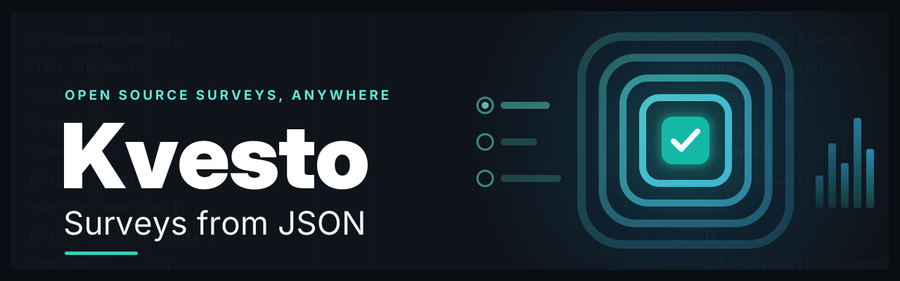

<p align="center"></p>

# Kvesto

Kvesto is a fully open source survey library. Define surveys as JSON and render them anywhere with a
lightweight JavaScript core. Build surveys visually in the editor and explore responses in the dashboard.

Storage is just a setting. Keep responses in the browser, plug in your own backend, or use the included Hono server
with SQLite and documented OpenAPI endpoints. Everything is MIT, including the editor and the dashboard.

> **Status:** early skeleton. The architecture, contracts and tests are in place; features are minimal.

## Architecture

```
@kvesto/schema   Zod schemas for the versioned survey JSON (shared by core, server and the OpenAPI spec)
      │
@kvesto/core     createSurvey({ survey, storage? }), validation, paging, DOM renderer
      │          no backend and no framework required
      │
      ├── memoryStorage()          in-memory (tests, previews)
      ├── localStorageStorage()    responses stay in the browser
      └── httpStorage({ baseUrl }) ──REST + OpenAPI──▶ @kvesto/server (Hono + Drizzle, SQLite by default)

apps/editor, apps/dashboard (SvelteKit) use the core with whichever adapter is configured.
```

| Package | What it is |
| --- | --- |
| [`packages/schema`](packages/schema) | The survey JSON format (`schemaVersion: 1`) as Zod schemas, plus `migrateSurvey` for future format upgrades. |
| [`packages/core`](packages/core) | `createSurvey`, validation, paging, a plain-DOM renderer, `summarizeResponses`, and the `SurveyStorage` interface with three adapters. |
| [`packages/server`](packages/server) | REST API built with Hono, `@hono/zod-openapi` and Drizzle ORM on SQLite. Interactive docs at `/docs`. |
| [`apps/editor`](apps/editor) | SvelteKit visual builder (placeholder: JSON editor, question palette, live preview). |
| [`apps/dashboard`](apps/dashboard) | SvelteKit results dashboard (placeholder: survey list and per-question charts). |

### Storage is configuration

The core never talks to a server on its own. It accepts any object that implements `SurveyStorage`:

```ts
interface SurveyStorage {
  loadSurvey(id: string): Promise<Survey | null>;
  saveSurvey(survey: Survey): Promise<Survey>;
  saveResponse(surveyId: string, response: ResponseInput): Promise<SurveyResponse>;
  listSurveys?(): Promise<SurveySummary[]>;          // editor and dashboard
  listResponses?(surveyId: string): Promise<SurveyResponse[]>;
  deleteSurvey?(id: string): Promise<void>;
}
```

Bundled adapters: `memoryStorage()`, `localStorageStorage()`, and `httpStorage({ baseUrl })` for the Kvesto server
(or any backend that speaks the same OpenAPI contract). Pass no storage at all and you get the response in `onComplete`.

## Embedding a survey

```ts
import { mountSurvey } from "@kvesto/core";
import "@kvesto/core/styles.css"; // optional default theme

// 1. No backend: handle the answers yourself.
mountSurvey(document.getElementById("survey")!, {
  survey: mySurvey, // survey JSON object
  onComplete: ({ response }) => console.log(response.answers),
});

// 2. With the Kvesto server (or anything implementing the same REST contract).
import { httpStorage, loadSurvey, renderSurvey } from "@kvesto/core";
const storage = httpStorage({ baseUrl: "https://example.com/api" });
renderSurvey(el, await loadSurvey("customer-feedback", { storage }));
```

`SurveyModel` is DOM-free and its `subscribe` follows the Svelte store contract, so you can drive your own UI in
React, Vue or Svelte instead of using the bundled renderer.

### Survey JSON

```json
{
  "schemaVersion": 1,
  "id": "customer-feedback",
  "title": "Customer feedback",
  "pages": [
    {
      "id": "p1",
      "elements": [
        { "id": "email", "type": "text", "inputType": "email", "title": "Your email", "required": true },
        { "id": "nps", "type": "rating", "title": "How likely are you to recommend us?", "min": 0, "max": 10 },
        { "id": "role", "type": "single-choice", "title": "Your role",
          "choices": [{ "value": "dev", "label": "Developer" }, { "value": "pm", "label": "Product manager" }] }
      ]
    }
  ]
}
```

Question types: `text`, `comment`, `single-choice`, `multiple-choice`, `dropdown`, `rating`, `boolean`.

## The server

```sh
pnpm --filter @kvesto/server dev        # http://localhost:3000, docs at /docs
KVESTO_DB=./data/kvesto.db PORT=8080 pnpm --filter @kvesto/server start
```

| Method | Path | |
| --- | --- | --- |
| GET | `/health` | Health check |
| GET, POST | `/surveys` | List / create surveys |
| GET, PUT, DELETE | `/surveys/{id}` | Read / create-or-replace / delete a survey |
| GET, POST | `/surveys/{id}/responses` | List (paginated) / submit responses |
| GET | `/openapi.json`, `/docs` | OpenAPI 3.1 document and Scalar API reference |

Responses are validated against the survey with the same rules the core uses. To mount the API inside an existing
Hono app (and add your own auth middleware in front of it):

```ts
import { createApp, createSqliteDb, drizzleRepository } from "@kvesto/server";
parent.route("/api/kvesto", createApp({ repository: drizzleRepository(createSqliteDb("kvesto.db")) }));
```

`createApp` takes any `SurveyRepository`, so a Postgres or MySQL implementation (Drizzle supports both) can be
dropped in without touching the routes. Migrations live in `packages/server/drizzle` (`pnpm --filter @kvesto/server db:generate`).

## Development

Requires Node 20+ and pnpm 10.

```sh
pnpm install
pnpm build        # all packages and apps
pnpm typecheck
pnpm test         # schema, core (incl. DOM rendering) and API tests
pnpm dev:server   # API on :3000
pnpm dev:editor   # editor on :5173
pnpm dev:dashboard
```

The apps use `localStorage` by default. Set `VITE_KVESTO_API=http://localhost:3000` (see `.env.example` in each
app) to point them at the server.

Svelte markup is written in [BraceML](https://github.com/pavlovt/braceml) (`<template lang="braceml">`), compiled by
the `@braceml/svelte` preprocessor. `pnpm typecheck` compiles the templates first so svelte-check sees real markup.

## License

[MIT](LICENSE)
